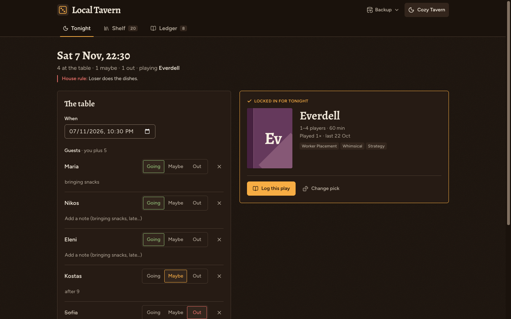
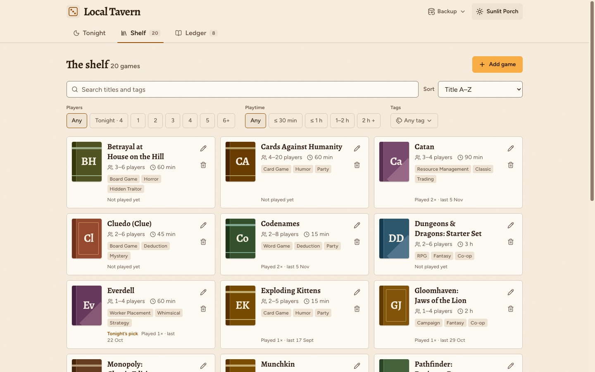
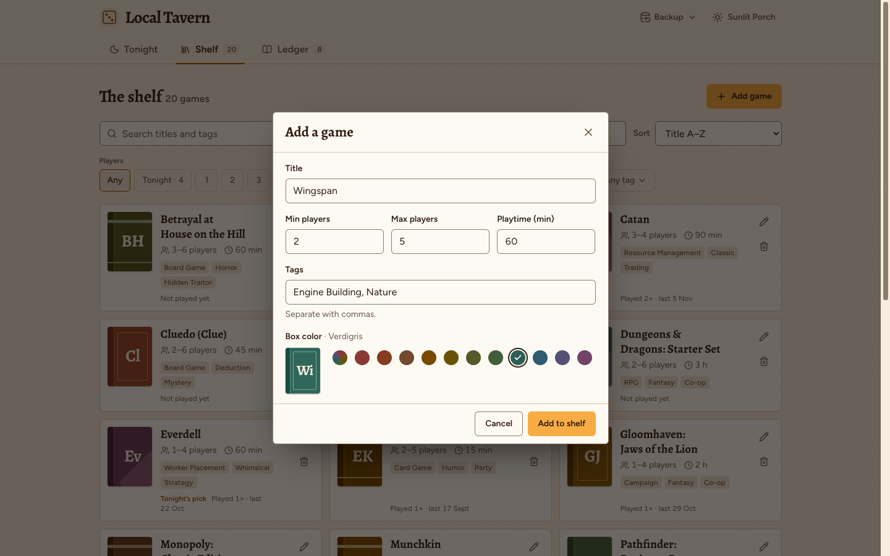
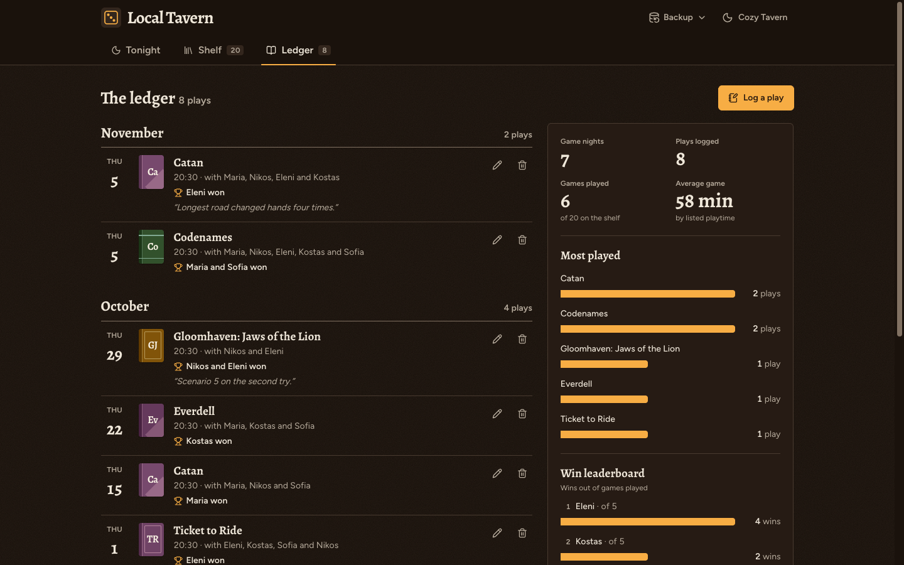

# Local Tavern

> "Pull up a chair, order a mug of mead, and let the Fates decide your next board game night."

**Local Tavern** is a cozy game-night companion built with **React**, **Tailwind CSS** and **Framer Motion**. It keeps your board game shelf, tonight's guest list, a Fate Wheel and a play ledger, all in your browser. No account, no server.

---

## Features

The app has three tabs (linked by URL hash: `#tonight`, `#shelf`, `#ledger`).

### Tonight
* **The table:** set the date and time, add guests and mark each one Going / Maybe / Out, with a note per guest and a house rule for the night.
* **The Fate Wheel:** spins over the games that seat everyone going (or with the maybes, or the whole shelf). Option to favor games gathering dust, veto chips, up to 16 slices with a reshuffle. Respects reduced motion.
* **Lock in the pick**, then log the play straight into the ledger.

### Shelf
* Game cards with generated box covers, player count, playtime, tags, play count and last played.
* Search, player-count chips (including "fits tonight"), playtime buckets, tag filter and six sort orders.
* Add and edit games in a validated dialog, with a box color picker (or let the title pick one); delete with **Undo**.

### Ledger
* **Log a play:** game, date, who played (guests and past players, or type a new name), who won, and a note. Edit or delete any play (with Undo).
* Plays grouped by month.
* **Stats:** game nights, plays, games played, average game length, most played, win leaderboard and the games gathering dust.

### Backup and sharing
* **Export** everything (games, plays, tonight) as a JSON file.
* **Import** a backup by merging it into what is there or replacing everything, with Undo.
* **Copy night summary:** date, pick, guests and house rule as plain text for the group chat.

### Everywhere
* **Persistent storage** in `localStorage` (versioned; data from older versions migrates automatically).
* **Cozy Tavern** (dark) and **Sunlit Porch** (light) themes; follows your system setting until you pick one.
* Keyboard and screen-reader friendly: ARIA tabs and menus, native dialogs, labelled controls.

## Development

```bash
npm install
npm run dev     # start the dev server
npm run lint
npm run build
```

## Screenshots





