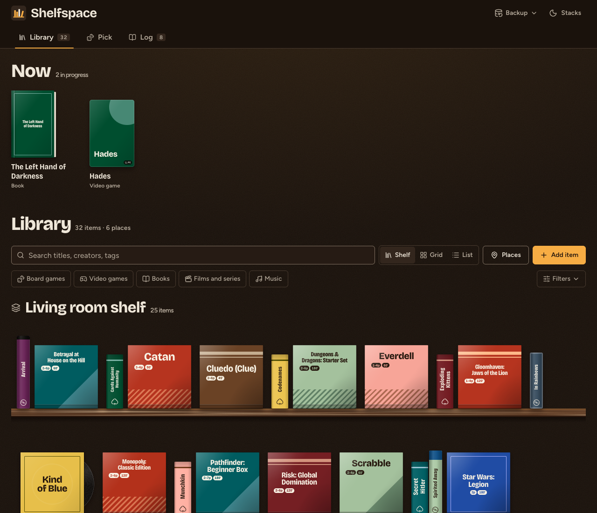
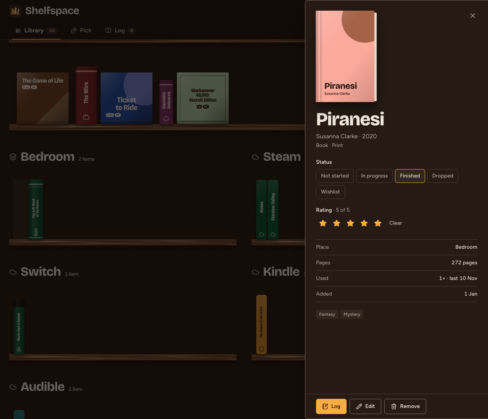
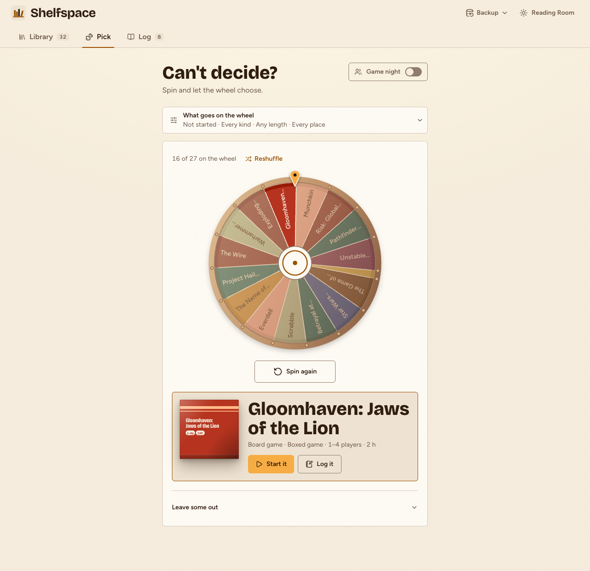
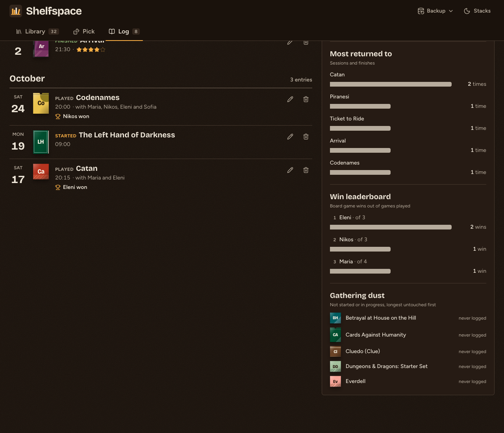
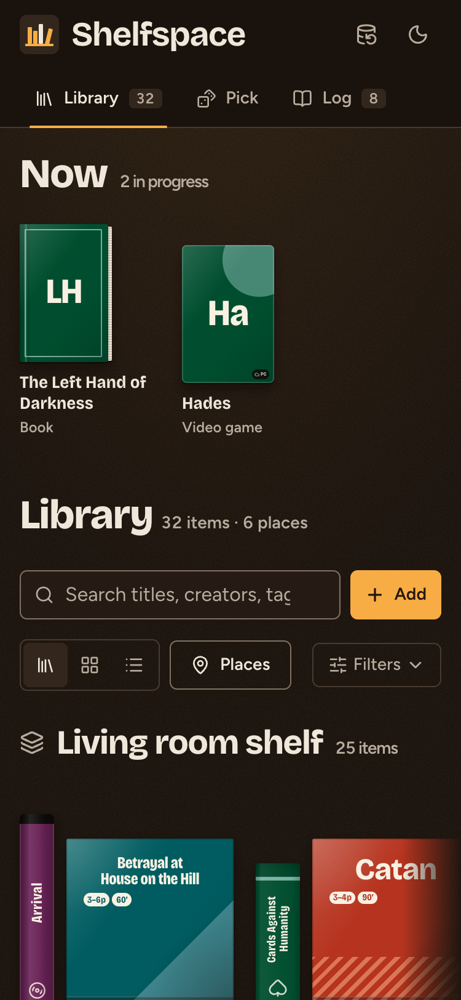

# Shelfspace

**Shelfspace** is a personal library for everything you own or want: board and card games, video games, books, films and series, and music, kept across the real and digital places they live. Each item is drawn as its real object (a game box, a paperback, a keep-case, a record sleeve) standing on wooden shelves. When you can't decide what's next, a wheel picks for you, and an activity log remembers what you played, read, watched and heard.

Built with **React**, **Tailwind CSS** and **Framer Motion**. Everything stays in your browser: no account, no server.

---

## Features

The app has three tabs, linked by URL hash: `#library`, `#pick` and `#log`.

### Library
* **Shelf view:** one wooden shelf per place (Living room shelf, Bedroom, Steam, Switch, Kindle, Audible, Apple TV, Bandcamp, or your own). Books, films and games stand as spines; boxed games and records stand face-out. On phones each shelf scrolls sideways.
* **Grid and List views** for browsing covers or scanning a dense list.
* **Covers drawn per format:** board game box or card tuck box; paperback, ebook reader or audiobook; game case, cartridge or launcher tile; Blu-ray, DVD or series box set; vinyl sleeve or CD jewel case. Add your own image (upload or link) and it goes inside the object frame.
* **Now:** what you're in the middle of, face-out at the top.
* **Filters:** kind, place, status (Not started, In progress, Finished, Dropped, Wishlist), length, player count and tags, with seven sort orders.
* **Detail sheet:** pull an item off the shelf to change its status or rating, see its facts and log it. Remove anything with **Undo**.
* **Places:** add, rename and remove the places your things live, physical or digital.

### Pick
* **The wheel** spins over whatever fits: by status, kind, time you have, place and tags. It can favor what's gathering dust. Up to 16 slices, with a reshuffle, and you can leave items out for the round.
* **Start it** puts the winner on your Now shelf; **Log it** records a session straight away.
* **Game night mode:** set the date, add guests and mark each one Going, Maybe or Out, add a house rule, and let the wheel pick only games that seat the table. Lock in the pick, then log the session with the guests filled in.

### Log
* **Log** when you start, finish or sit down with something: date, players and winners for games, a rating and a note.
* Entries grouped by month, filtered by kind; edit or delete any of them (with Undo).
* **Stats:** the year in one sentence (things finished, game nights, pages read, hours played, watched and heard), entries by kind, what you return to most, a win leaderboard and what's gathering dust.

### Backup
* **Export** the library, places and log as a JSON file, optionally with your uploaded cover images.
* **Import** a backup by merging or replacing, with Undo. Backups from Local Tavern, the app's earlier name, still import.
* **Copy night summary:** date, pick, guests and house rule as plain text for the group chat.

### Everywhere
* **Local storage:** data in `localStorage`, cover images in IndexedDB. Data from older versions migrates automatically.
* **Stacks** (dark) and **Reading Room** (light) themes. The app follows your system setting until you pick one.
* Keyboard and screen-reader friendly: ARIA tabs, arrow keys along each shelf, native dialogs, labelled controls. Respects reduced motion.

## Development

```bash
npm install
npm run dev     # start the dev server
npm run lint
npm run build
```

## Screenshots






